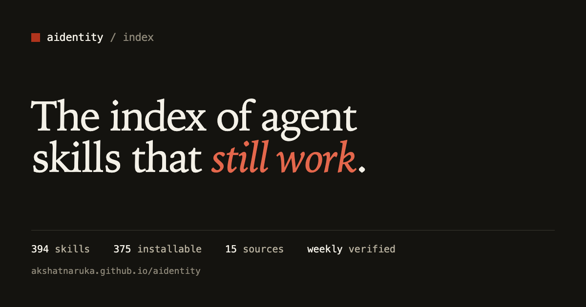
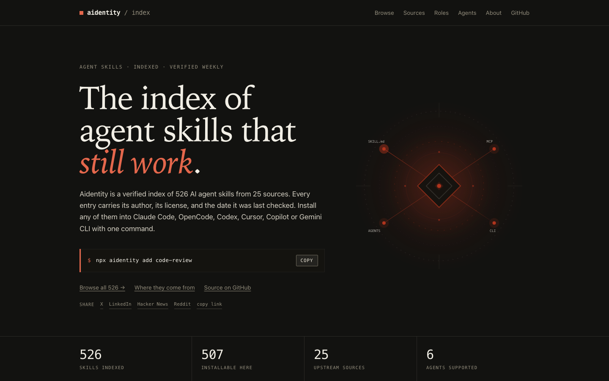
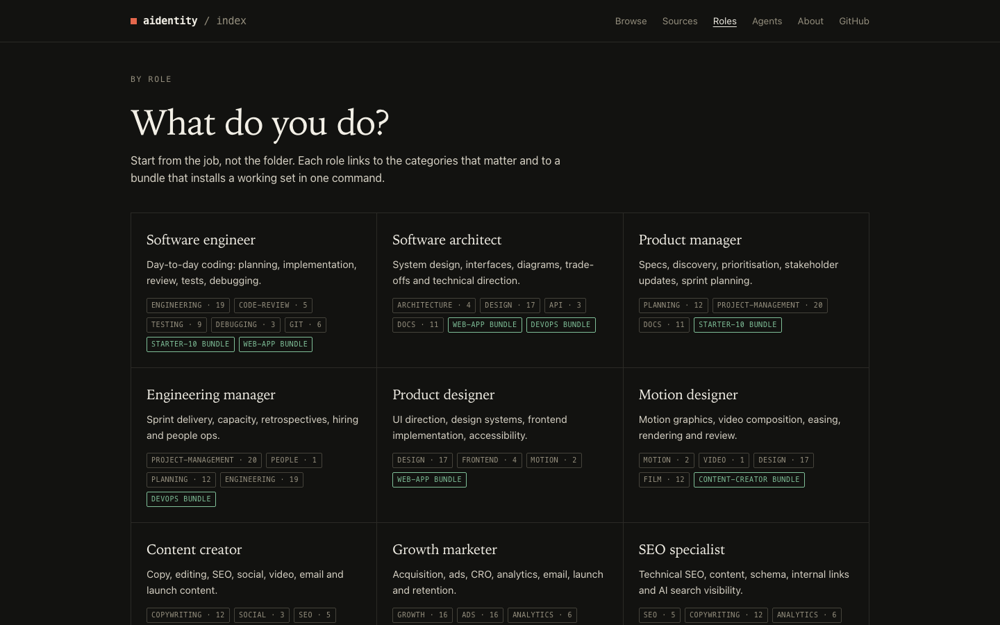
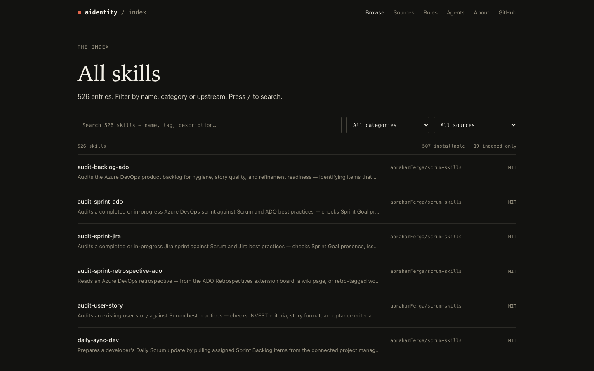
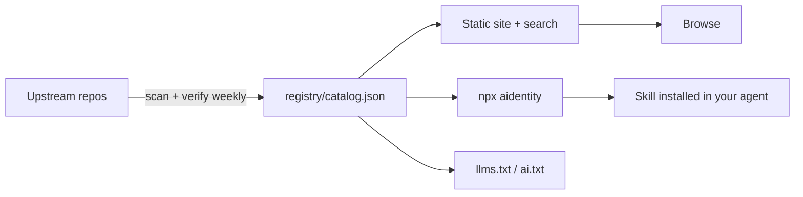

<div align="center">



<h1>Aidentity</h1>

<p><strong>The verified index of AI agent skills.</strong><br>One ID. One command. Works in every coding agent.</p>

<a href="https://akshatnaruka.github.io/aidentity/"></a>
<a href="https://www.npmjs.com/package/aidentity"></a>
<a href="https://www.npmjs.com/package/aidentity"></a>
<a href="https://github.com/AkshatNaruka/aidentity/stargazers"></a>
<a href="https://github.com/AkshatNaruka/aidentity/forks"></a>
<a href="https://github.com/AkshatNaruka/aidentity/commits/main"></a>
<a href="https://github.com/AkshatNaruka/aidentity/issues"></a>
<a href="https://github.com/AkshatNaruka/aidentity/graphs/contributors"></a>
<a href="LICENSE"></a>

<a href="https://akshatnaruka.github.io/aidentity/">Browse</a> ·
<a href="https://akshatnaruka.github.io/aidentity/roles/">By role</a> ·
<a href="https://akshatnaruka.github.io/aidentity/llms.txt">llms.txt</a> ·
<a href="https://akshatnaruka.github.io/aidentity/registry.json">Registry</a> ·
<a href="https://www.npmjs.com/package/aidentity">npm</a>

</div>

> **526 skills · 507 installable · 25 sources · 47 categories · re-verified weekly**

```bash
npx aidentity add code-review
```

Skills are the new packages. There are thousands of them, spread across dozens of repositories, with no search, no install path, no license clarity, and no way to tell which ones still work. Aidentity is the missing index: each entry carries its author, license, source and last verification date, and installs into the agent you already use.

---

## Contents

- [Why Aidentity](#why-aidentity)
- [What it looks like](#what-it-looks-like)
- [Quick start](#quick-start)
- [Start here](#start-here)
- [By role](#by-role)
- [What's inside](#whats-inside)
- [Sources](#sources)
- [How it works](#how-it-works)
- [For AI agents](#for-ai-agents)
- [FAQ](#faq)
- [Contributing](#contributing)
- [Support](#support)
- [Star history](#star-history)
- [License](#license)

---

## Why Aidentity

| | Awesome lists | Aidentity |
|---|---|---|
| **Format** | Markdown you scroll | Registry + search + machine-readable JSON |
| **Install** | Copy-paste by hand | `npx aidentity add <id>` into six agents |
| **Freshness** | Silently rots | Weekly CI re-checks every source; dead entries flagged |
| **License** | Unstated | Every entry states its license and origin |
| **For agents** | Unreadable | `search.json`, `llms.txt`, `agent.json`, MCP server |

This is an index, not a fork. Every skill belongs to its author.

---

## What it looks like

<p align="center">
  <a href="https://akshatnaruka.github.io/aidentity/"></a>
</p>

<p align="center">
  <a href="https://akshatnaruka.github.io/aidentity/roles/"></a>
  <a href="https://akshatnaruka.github.io/aidentity/skills/"></a>
</p>

---

## Quick start

```bash
# Search the index
npx aidentity search "code review"

# Install into the agent you are in (auto-detected)
npx aidentity add mattpocock/engineering/code-review

# Pick the target explicitly
npx aidentity add systematic-debugging --agent cursor

# Install a task bundle
node scripts/install.js starter-10 --platform claude

# List by category
npx aidentity list --category testing
```

No config, no account, no vendor lock-in. The skill lands in `.claude/skills/`, `.cursor/skills/`, `.codex/skills/`, `.gemini/skills/`, `.opencode/skills/` or `.github/skills/`.

**Supported agents:** Claude Code · Cursor · Codex · Gemini CLI · OpenCode · GitHub Copilot

---

## Start here

| I want to… | Use |
|---|---|
| **Install a sensible default set** | `starter-10` — 10 skills that improve almost any codebase |
| **Build a web app** | `web-app` — design direction, frontend, API, Postgres, CRO, CI, launch |
| **Build a mobile app** | `mobile-app` — Expo Router, native UI, animation, EAS releases |
| **Write content / SEO / launch copy** | `content-creator` — copywriting, editing, SEO, social, video, email, ads |
| **Audit security before shipping** | `security-review` — audit context, supply chain, agentic actions, second opinion |
| **Work with data or AI** | `data-ai` — Postgres, BigQuery AI, context engineering, evals, observability |
| **Set up CI / deploy / cloud** | `devops` — CI, shipping, observability, Cloud Run, GKE |
| **Work on GCP or Azure** | `cloud` — optional 11-skill megapack |

Full task router: **[INDEX.md](INDEX.md)** · bundles: **[bundles/](bundles/)** · site: **[bundles page](https://akshatnaruka.github.io/aidentity/bundles/)**

---

## By role

Twenty roles mapped to categories and bundles — engineer, architect, product manager, designer, motion designer, marketer, SEO, finance, quant, music producer, filmmaker, journalist, legal, sales, support, teacher, HR.

**[Open the role router →](https://akshatnaruka.github.io/aidentity/roles/)** · **[ROLES.md](ROLES.md)**

---

## What's inside

| Type | Count | Where |
|---|---:|---|
| Skills | **526** (507 installable, 19 index-only) | [`skills/`](skills/) · [registry](registry/skills.json) |
| MCP tools | 12 | [`tools/README.md`](tools/README.md) |
| Hooks | 4 | [`hooks/`](hooks/) |
| Slash commands | 5 | [`commands/`](commands/) |
| Subagents | 7 scoped | [`agents/`](agents/) |
| Bundles | 8 | [`bundles/`](bundles/) |
| Language rules | 5 | [`rules/`](rules/) |
| Templates | 3 real stacks | [`templates/`](templates/) |
| Prompts | 256 Fabric patterns | [`prompts/`](prompts/) |
| Memory | patterns + project template | [`memory/`](memory/) |

Machine-readable index: [`registry/catalog.json`](registry/catalog.json) — 595 entries with a `type` field. Generated by `scripts/build-catalog.js`, never hand-edited.

---

## Sources

<details>
<summary><strong>All 25 upstream repositories</strong> (click to expand)</summary>

| Repository | Skills | License | Hosted |
|---|---:|---|---|
| [google/skills](https://github.com/google/skills) | 127 | Apache-2.0 | yes |
| [microsoft/skills](https://github.com/microsoft/skills) | 61 | MIT | yes |
| [OpenSenseNova/SenseNova-Skills](https://github.com/OpenSenseNova/SenseNova-Skills) | 59 | MIT | yes |
| [coreyhaines31/marketingskills](https://github.com/coreyhaines31/marketingskills) | 52 | MIT | yes |
| [mattpocock/skills](https://github.com/mattpocock/skills) | 37 | MIT | yes |
| [addyosmani/agent-skills](https://github.com/addyosmani/agent-skills) | 25 | MIT | yes |
| [expo/skills](https://github.com/expo/skills) | 23 | MIT | yes |
| [anthropics/skills](https://github.com/anthropics/skills) | 19 | LicenseRef-Proprietary | **no — index only** |
| [abrahamFerga/scrum-skills](https://github.com/abrahamFerga/scrum-skills) | 17 | MIT | yes |
| [obra/superpowers](https://github.com/obra/superpowers) | 14 | MIT | yes |
| [agentii-ai/agentii-investment-intelligence](https://github.com/agentii-ai/agentii-investment-intelligence) | 12 | Apache-2.0 | yes |
| [agiprolabs/claude-trading-skills](https://github.com/agiprolabs/claude-trading-skills) | 12 | MIT | yes |
| [jtydhr88/lyric-writing-skills](https://github.com/jtydhr88/lyric-writing-skills) | 12 | MIT | yes |
| [jtydhr88/screenwriting-skills](https://github.com/jtydhr88/screenwriting-skills) | 12 | MIT | yes |
| [affaan-m/everything-claude-code](https://github.com/affaan-m/everything-claude-code) | 10 | MIT | yes |
| [JuliusBrussee/caveman](https://github.com/JuliusBrussee/caveman) | 8 | Apache-2.0 | yes |
| [trailofbits/skills](https://github.com/trailofbits/skills) | 7 | CC-BY-SA-4.0 | yes |
| [nextlevelbuilder/ui-ux-pro-max-skill](https://github.com/nextlevelbuilder/ui-ux-pro-max-skill) | 6 | MIT | yes |
| [emmapbingham/agentic-newsroom](https://github.com/emmapbingham/agentic-newsroom) | 4 | MIT | yes |
| [lukedj78/dev-flow](https://github.com/lukedj78/dev-flow) | 2 | MIT | yes |
| [supabase/agent-skills](https://github.com/supabase/agent-skills) | 2 | MIT | yes |
| [codeswithroh/tastemaker](https://github.com/codeswithroh/tastemaker) | 2 | MIT | yes |
| [Agents365-ai/drawio-skill](https://github.com/Agents365-ai/drawio-skill) | 1 | MIT | yes |
| [haidrrrry/claude-remotion-skill](https://github.com/haidrrrry/claude-remotion-skill) | 1 | MIT | yes |
| [AkshatNaruka/aidentity](https://github.com/AkshatNaruka/aidentity) | 1 | MIT | yes |
</details>

> **On the Anthropic entries:** 19 skills ship under a license that does not permit redistribution. They are indexed with a name, description and upstream link, but the content is not hosted here.

Full provenance: [`registry/skills.json`](registry/skills.json) · [`THIRD_PARTY_NOTICES.md`](THIRD_PARTY_NOTICES.md).

---

## How it works



```bash
node scripts/build-registry.js     # skills
node scripts/build-catalog.js      # unified catalog
node scripts/check-licenses.js     # legal gate
node scripts/validate.js           # frontmatter, bundles, links
node site/build.js                 # static site
```

---

## For AI agents

Give an agent one URL: **https://akshatnaruka.github.io/aidentity/llms.txt**

| Endpoint | Use |
|---|---|
| [`llms.txt`](https://akshatnaruka.github.io/aidentity/llms.txt) | Key facts + one line per skill |
| [`search.json`](https://akshatnaruka.github.io/aidentity/search.json) | Compact index for local filtering (~350 KB) |
| [`llms-full.txt`](https://akshatnaruka.github.io/aidentity/llms-full.txt) | Metadata, install and instruction URL per skill |
| [`agent.json`](https://akshatnaruka.github.io/aidentity/agent.json) | Manifest: endpoints, counts, usage rules |
| [`registry.json`](https://akshatnaruka.github.io/aidentity/registry.json) | Full registry, CC0 |
| [`ai.txt`](https://akshatnaruka.github.io/aidentity/ai.txt) | Citation and attribution preferences |

Agents can also run the repo’s MCP server:

```bash
node cli/mcp.js   # search_skills, recommend, get_skill, list_bundles, install_skill
```

Full instructions: **[for-agents](https://akshatnaruka.github.io/aidentity/for-agents/)**.

---

## FAQ

**Is this another awesome list?**
No. It is a generated registry with schema validation, a license gate, weekly upstream checks and an install CLI. The site and README are views of the same data.

**Are the skills free?**
Most are MIT or Apache-2.0. Trail of Bits content is CC BY-SA 4.0. 19 Anthropic skills are index-only. Every page states the license before you install.

**How do you keep it accurate?**
CI rebuilds the registry and checks the license policy on every change. A manual verify job requests every upstream, writes `registry/verified.json`, and opens a report PR when a source is unreachable.

**Can I add a skill?**
Yes — one JSON record per pull request. See [CONTRIBUTING.md](CONTRIBUTING.md). CI validates the schema, the license and that the source resolves.

**Does it work with my agent?**
Claude Code, Cursor, Codex, Gemini CLI, OpenCode and GitHub Copilot. The registry is plain JSON, so anything that can read a file can use it.

---

## Contributing

Adding a skill is one JSON record and a pull request — usually under 30 seconds.

```bash
./scripts/check-all.sh
```

See [CONTRIBUTING.md](CONTRIBUTING.md) and the [submit-a-skill](.github/ISSUE_TEMPLATE/submit-a-skill.yml) form. No GitHub Actions minutes are required: manual submissions are the primary path and are reviewed locally.

---

## Support

Aidentity is free and the registry is CC0. If it saved you time, you can fund the weekly verification and new imports:

- **[Buy Me a Coffee](https://buymeacoffee.com/narukaakshat)**
- **[PayPal](https://paypal.me/AkshatNaruka007)**

<a href="https://buymeacoffee.com/narukaakshat"></a>

Nothing is paywalled. Contributing a skill or reporting a dead link is just as useful.

---

## Star history

<a href="https://star-history.com/#AkshatNaruka/aidentity&Date">
  
</a>

**Contributors**

<a href="https://github.com/AkshatNaruka/aidentity/graphs/contributors">
  
</a>

---

## License

- **Code** (`cli/`, `site/`, `scripts/`) — MIT
- **Registry data** (`registry/*.json`) — CC0 1.0. Use it for anything.
- **Original writing** (`docs/`, `rules/`, `bundles/`) — CC BY 4.0
- **Vendored skills** — their upstream licenses, preserved per directory

Aidentity is an index, not a fork. Every skill belongs to its author.
