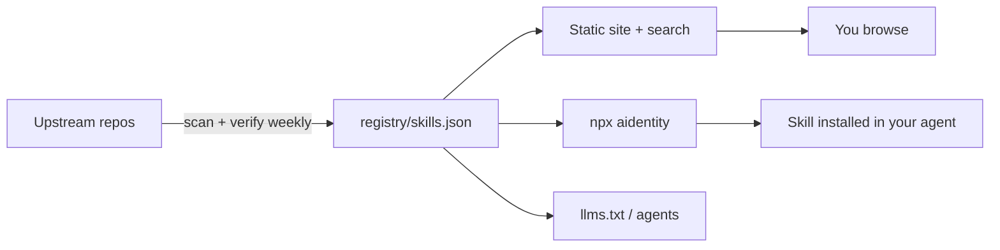

# Aidentity

> **The verified index of agent skills.** One ID. One command. Works in every coding agent.
>
> `npx aidentity add code-review`

**394 skills indexed · 375 installable · 15 sources · re-verified weekly**

Skills are the new packages. There are thousands of them, spread across dozens of repos, with no search, no install path, no license clarity, and no way to tell which ones still work. Aidentity is the missing index.

## Sources

| Repository | Skills | License | Hosted |
|---|---:|---|---|
| [google/skills](https://github.com/google/skills) | 127 | Apache-2.0 | yes |
| [microsoft/skills](https://github.com/microsoft/skills) | 61 | MIT | yes |
| [coreyhaines31/marketingskills](https://github.com/coreyhaines31/marketingskills) | 52 | MIT | yes |
| [mattpocock/skills](https://github.com/mattpocock/skills) | 37 | MIT | yes |
| [addyosmani/agent-skills](https://github.com/addyosmani/agent-skills) | 25 | MIT | yes |
| [expo/skills](https://github.com/expo/skills) | 23 | MIT | yes |
| [anthropics/skills](https://github.com/anthropics/skills) | 19 | LicenseRef-Proprietary | **no — index only** |
| [obra/superpowers](https://github.com/obra/superpowers) | 14 | MIT | yes |
| [affaan-m/everything-claude-code](https://github.com/affaan-m/everything-claude-code) | 10 | MIT | yes |
| [JuliusBrussee/caveman](https://github.com/JuliusBrussee/caveman) | 8 | Apache-2.0 | yes |
| [trailofbits/skills](https://github.com/trailofbits/skills) | 7 | CC-BY-SA-4.0 | yes |
| [nextlevelbuilder/ui-ux-pro-max-skill](https://github.com/nextlevelbuilder/ui-ux-pro-max-skill) | 6 | MIT | yes |
| [supabase/agent-skills](https://github.com/supabase/agent-skills) | 2 | MIT | yes |
| [codeswithroh/tastemaker](https://github.com/codeswithroh/tastemaker) | 2 | MIT | yes |
| [AkshatNaruka/aidentity](https://github.com/AkshatNaruka/aidentity) | 1 | MIT | yes |

> **On the Anthropic entries|---|---|
| [google/skills](https://github.com/google/skills) | 127 | Apache-2.0 | yes |
| [microsoft/skills](https://github.com/microsoft/skills) | 61 | MIT | yes |
| [coreyhaines31/marketingskills](https://github.com/coreyhaines31/marketingskills) | 52 | MIT | yes |
| [mattpocock/skills](https://github.com/mattpocock/skills) | 37 | MIT | yes |
| [addyosmani/agent-skills](https://github.com/addyosmani/agent-skills) | 25 | MIT | yes |
| [expo/skills](https://github.com/expo/skills) | 23 | MIT | yes |
| [anthropics/skills](https://github.com/anthropics/skills) | 19 | LicenseRef-Proprietary | **no — index only** |
| [obra/superpowers](https://github.com/obra/superpowers) | 14 | MIT | yes |
| [trailofbits/skills](https://github.com/trailofbits/skills) | 9 | CC-BY-SA-4.0 | yes |
| [JuliusBrussee/caveman](https://github.com/JuliusBrussee/caveman) | 8 | Apache-2.0 | yes |
| [nextlevelbuilder/ui-ux-pro-max-skill](https://github.com/nextlevelbuilder/ui-ux-pro-max-skill) | 6 | MIT | yes |
| [supabase/agent-skills](https://github.com/supabase/agent-skills) | 2 | MIT | yes |
| [codeswithroh/tastemaker](https://github.com/codeswithroh/tastemaker) | 2 | MIT | yes |
| [AkshatNaruka/aidentity](https://github.com/AkshatNaruka/aidentity) | 1 | MIT | yes |

> **On the Anthropic entries

## Why this isn't another awesome-list

| | Awesome lists | Aidentity |
|---|---|---|
| Format | Markdown you scroll | Registry + search + machine-readable JSON |
| Install | Copy-paste by hand | `npx aidentity add <id>` into Claude Code, OpenCode, Codex, Cursor, Copilot, Gemini CLI |
| Freshness | Silently rots | Weekly CI re-checks every source; dead entries flagged |
| License | Unstated | Every entry states its license and origin |
| For agents | Unreadable | `registry/skills.json` + `llms.txt` |

Every entry carries its upstream repo, author, license, status (`stable` / `in-progress` / `deprecated`) and a `verified_at` date. If we can't verify it, we don't list it.

---

## Quick start

```bash
# Find something
npx aidentity search "code review"

# Install into whichever agent you're in (auto-detected)
npx aidentity add mattpocock/engineering/code-review

# Or pick the target explicitly
npx aidentity add systematic-debugging --agent cursor

# See what's in the registry
npx aidentity list --category testing
```

No config. No account. No vendor lock-in — the skill lands in `.claude/skills/`, `.opencode/skills/`, `.codex/skills/`, `.cursor/skills/`, `.github/skills/` or `.gemini/skills/` depending on where you are.

---

## Browse

- **[Browse the index](https://akshatnaruka.github.io/aidentity)** — search, filter by category / source / license
- **[Registry](registry/skills.json)** — the raw data, CC0
- **[Sources](https://akshatnaruka.github.io/aidentity/sources/)** — provenance and license for every upstream
- **[llms.txt](https://akshatnaruka.github.io/aidentity/llms.txt)** — the same index, written for agents

---

## What's inside

| Directory | What it is |
|---|---|
| `registry/` | The data spine: `skills.json`, `sources.json`, `pointers/`, `verified.json`, `schema.json` |
| `skills/` | Vendored skills from redistributable sources, each with its upstream `LICENSE` |
| `cli/` | `aidentity` — search, install, list |
| `site/` | Zero-dependency static site generator → GitHub Pages |
| `prompts/` | 256 Fabric patterns (MIT) plus original domain prompts |
| `agents/` | Agent definitions and free-model routing configs |
| `memory/` | Memory patterns and integration notes |
| `templates/` | Project templates (Next.js, React, Python, Go, Rust) |
| `references/` | Curated links to the wider ecosystem |
| `scripts/` | Registry builder, license gate, upstream verifier, notices generator |
| `docs/` | Setup, routing, best practices, and the open-source plan |

---

## Sources

| Repository | Skills | License | Hosted |
|---|---:|---|---|
| [mattpocock/skills](https://github.com/mattpocock/skills) | 37 | MIT | yes |
| [obra/superpowers](https://github.com/obra/superpowers) | 14 | MIT | yes |
| [addyosmani/agent-skills](https://github.com/addyosmani/agent-skills) | 25 | MIT | yes |
| [google/skills](https://github.com/google/skills) | 127 | Apache-2.0 | yes |
| [microsoft/skills](https://github.com/microsoft/skills) | 61 | MIT | yes |
| [anthropics/skills](https://github.com/anthropics/skills) | 19 | LicenseRef-Proprietary | **no — index only** |
| [AkshatNaruka/aidentity](https://github.com/AkshatNaruka/aidentity) | 1 | MIT | yes |
| [nextlevelbuilder/ui-ux-pro-max-skill](https://github.com/nextlevelbuilder/ui-ux-pro-max-skill) | 6 | MIT | yes |
| [codeswithroh/tastemaker](https://github.com/codeswithroh/tastemaker) | 2 | MIT | yes |
| [expo/skills](https://github.com/expo/skills) | 23 | MIT | yes |
| [supabase/agent-skills](https://github.com/supabase/agent-skills) | 2 | MIT | yes |
| [coreyhaines31/marketingskills](https://github.com/coreyhaines31/marketingskills) | 52 | MIT | yes |
| [JuliusBrussee/caveman](https://github.com/JuliusBrussee/caveman) | 8 | Apache-2.0 | yes |
| [trailofbits/skills](https://github.com/trailofbits/skills) | 9 | CC-BY-SA-4.0 | yes |

> **On the Anthropic entries:** those skills ship under a license that does not permit redistribution. We index them — name, description, origin, upstream link — but we do not host the content. If that changes upstream, they become installable here automatically.

Full provenance for every file is in [`registry/skills.json`](registry/skills.json) and [`THIRD_PARTY_NOTICES.md`](THIRD_PARTY_NOTICES.md).

---

## How it works



Nothing is scraped at runtime. The registry is built by CI, validated against a JSON Schema, and served as static files.

```bash
# Rebuild the registry
node scripts/build-registry.js

# Enforce the license policy
node scripts/check-licenses.js

# Build the site
node site/build.js && node site/serve.js
```

---

## Contributing

Adding a skill is one JSON record and a pull request — usually under 30 seconds of work.

```bash
node scripts/build-registry.js
node scripts/check-licenses.js
```

See [CONTRIBUTING.md](CONTRIBUTING.md) and the [submit-a-skill](.github/ISSUE_TEMPLATE/submit-skill.yml) issue form. We merge fast: if your entry is accurate and correctly licensed, it ships the same day.

---

## License

- **Code** (`cli/`, `site/`, `scripts/`) — MIT
- **Registry data** (`registry/*.json`) — CC0 1.0. Use it for anything.
- **Original writing** (`docs/`) — CC BY 4.0
- **Vendored skills** — their upstream licenses, preserved per directory

Aidentity is an index, not a fork. Every skill belongs to its author.
