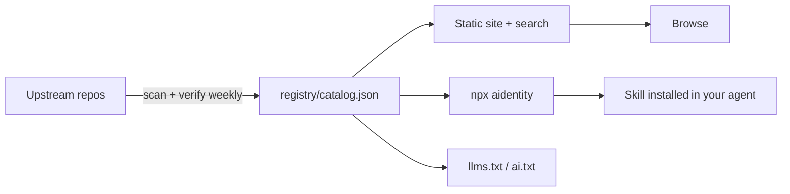

# Aidentity

**The verified index of AI agent skills.** One ID, one command, works in every coding agent.

[](https://akshatnaruka.github.io/aidentity/skills/)
[](https://akshatnaruka.github.io/aidentity/skills/)
[](https://akshatnaruka.github.io/aidentity/sources/)
[](LICENSE)
[](CONTRIBUTING.md)

**[Browse the index](https://akshatnaruka.github.io/aidentity/)** · **[Read llms.txt](https://akshatnaruka.github.io/aidentity/llms.txt)** · **[Registry JSON](https://akshatnaruka.github.io/aidentity/registry.json)**

```bash
npx aidentity add mattpocock/engineering/code-review
```

Skills are the new packages. There are thousands of them, spread across dozens of repositories, with no search, no install path, no license clarity, and no way to tell which ones still work. Aidentity is the missing index: **526 skills from 25 sources, each with its author, license and last verification date**, installable into the agent you already use.

## Sources

| Repository | Skills | License | Hosted |
|---|---:|---|---|
| [google/skills](https://github.com/google/skills) | 127 | Apache-2.0 | yes |
| [microsoft/skills](https://github.com/microsoft/skills) | 61 | MIT | yes |
| [OpenSenseNova/SenseNova-Skills](https://github.com/OpenSenseNova/SenseNova-Skills) | 59 | MIT | yes |
| [coreyhaines31/marketingskills](https://github.com/coreyhaines31/marketingskills) | 52 | MIT | yes |
| [mattpocock/skills](https://github.com/mattpocock/skills) | 37 | MIT | yes |
| [addyosmani/agent-skills](https://github.com/addyosmani/agent-skills) | 25 | MIT | yes |
| [expo/skills](https://github.com/expo/skills) | 23 | MIT | yes |
| [anthropics/skills](https://github.com/anthropics/skills) | 19 | LicenseRef-Proprietary | **no — index only** |
| [abrahamFerga/scrum-skills](https://github.com/abrahamFerga/scrum-skills) | 17 | MIT | yes |
| [obra/superpowers](https://github.com/obra/superpowers) | 14 | MIT | yes |
| [agentii-ai/agentii-investment-intelligence](https://github.com/agentii-ai/agentii-investment-intelligence) | 12 | Apache-2.0 | yes |
| [agiprolabs/claude-trading-skills](https://github.com/agiprolabs/claude-trading-skills) | 12 | MIT | yes |
| [jtydhr88/lyric-writing-skills](https://github.com/jtydhr88/lyric-writing-skills) | 12 | MIT | yes |
| [jtydhr88/screenwriting-skills](https://github.com/jtydhr88/screenwriting-skills) | 12 | MIT | yes |
| [affaan-m/everything-claude-code](https://github.com/affaan-m/everything-claude-code) | 10 | MIT | yes |
| [JuliusBrussee/caveman](https://github.com/JuliusBrussee/caveman) | 8 | Apache-2.0 | yes |
| [trailofbits/skills](https://github.com/trailofbits/skills) | 7 | CC-BY-SA-4.0 | yes |
| [nextlevelbuilder/ui-ux-pro-max-skill](https://github.com/nextlevelbuilder/ui-ux-pro-max-skill) | 6 | MIT | yes |
| [emmapbingham/agentic-newsroom](https://github.com/emmapbingham/agentic-newsroom) | 4 | MIT | yes |
| [lukedj78/dev-flow](https://github.com/lukedj78/dev-flow) | 2 | MIT | yes |
| [supabase/agent-skills](https://github.com/supabase/agent-skills) | 2 | MIT | yes |
| [codeswithroh/tastemaker](https://github.com/codeswithroh/tastemaker) | 2 | MIT | yes |
| [Agents365-ai/drawio-skill](https://github.com/Agents365-ai/drawio-skill) | 1 | MIT | yes |
| [haidrrrry/claude-remotion-skill](https://github.com/haidrrrry/claude-remotion-skill) | 1 | MIT | yes |
| [AkshatNaruka/aidentity](https://github.com/AkshatNaruka/aidentity) | 1 | MIT | yes |

> **On the Anthropic|---|---|
| [google/skills](https://github.com/google/skills) | 127 | Apache-2.0 | yes |
| [microsoft/skills](https://github.com/microsoft/skills) | 61 | MIT | yes |
| [coreyhaines31/marketingskills](https://github.com/coreyhaines31/marketingskills) | 52 | MIT | yes |
| [mattpocock/skills](https://github.com/mattpocock/skills) | 37 | MIT | yes |
| [addyosmani/agent-skills](https://github.com/addyosmani/agent-skills) | 25 | MIT | yes |
| [expo/skills](https://github.com/expo/skills) | 23 | MIT | yes |
| [anthropics/skills](https://github.com/anthropics/skills) | 19 | LicenseRef-Proprietary | **no — index only** |
| [obra/superpowers](https://github.com/obra/superpowers) | 14 | MIT | yes |
| [affaan-m/everything-claude-code](https://github.com/affaan-m/everything-claude-code) | 10 | MIT | yes |
| [JuliusBrussee/caveman](https://github.com/JuliusBrussee/caveman) | 8 | Apache-2.0 | yes |
| [trailofbits/skills](https://github.com/trailofbits/skills) | 7 | CC-BY-SA-4.0 | yes |
| [nextlevelbuilder/ui-ux-pro-max-skill](https://github.com/nextlevelbuilder/ui-ux-pro-max-skill) | 6 | MIT | yes |
| [supabase/agent-skills](https://github.com/supabase/agent-skills) | 2 | MIT | yes |
| [codeswithroh/tastemaker](https://github.com/codeswithroh/tastemaker) | 2 | MIT | yes |
| [haidrrrry/claude-remotion-skill](https://github.com/haidrrrry/claude-remotion-skill) | 1 | MIT | yes |
| [AkshatNaruka/aidentity](https://github.com/AkshatNaruka/aidentity) | 1 | MIT | yes |

> **On the Anthropic

## Why this exists

| Problem | What Aidentity does |
|---|---|
| **Links rot silently** | CI re-checks every upstream weekly and records the result. Dead sources are flagged, not ignored. |
| **Licenses are invisible** | Every entry states its license and origin. Content we cannot redistribute is indexed as a pointer, not copied. |
| **Every agent invents its own folder** | One skill ID installs into Claude Code, Cursor, Codex, Gemini CLI, OpenCode and Copilot. |

This is an index, not a fork. Every skill belongs to its author.

---

## Quick start

```bash
# Find something
npx aidentity search "code review"

# Install into the agent you are in (auto-detected)
npx aidentity add mattpocock/engineering/code-review

# Pick the target explicitly
npx aidentity add systematic-debugging --agent cursor

# Install a task bundle
node scripts/install.js starter-10 --platform claude

# Browse the registry
npx aidentity list --category testing
```

No config, no account, no vendor lock-in. The skill lands in `.claude/skills/`, `.cursor/skills/`, `.codex/skills/`, `.gemini/skills/`, `.opencode/skills/` or `.github/skills/`.

---

## Start here

| I want to… | Use |
|---|---|
| **Install a sensible default set** | `starter-10` — 10 skills that improve almost any codebase |
| **Build a web app** | `web-app` — design direction, frontend, API, Postgres, CRO, CI, launch |
| **Build a mobile app** | `mobile-app` — Expo Router, native UI, animation, EAS releases |
| **Write content / SEO / launch copy** | `content-creator` — copywriting, editing, SEO, social, video, email, ads |
| **Audit security before shipping** | `security-review` — audit context, supply chain, agentic actions, second opinion |
| **Work with data or AI** | `data-ai` — Postgres, BigQuery AI, context engineering, evals, observability |
| **Set up CI / deploy / cloud** | `devops` — CI, shipping, observability, Cloud Run, GKE |
| **Work on GCP or Azure specifically** | `cloud` — optional 11-skill megapack |

Full task router: **[INDEX.md](INDEX.md)** · by role: **[ROLES.md](ROLES.md)** · bundles: **[bundles/](bundles/)**.

---

## What's inside

| Type | Count | Where |
|---|---:|---|
| Skills | **526** (507 installable, 19 index-only) | [`skills/`](skills/) · [registry](registry/skills.json) |
| MCP tools | 12 | [`tools/README.md`](tools/README.md) |
| Hooks | 4 | [`hooks/`](hooks/) |
| Slash commands | 5 | [`commands/`](commands/) |
| Subagents | 7 scoped | [`agents/`](agents/) |
| Bundles | 8 | [`bundles/`](bundles/) |
| Language rules | 5 | [`rules/`](rules/) |
| Templates | 3 real stacks | [`templates/`](templates/) |
| Prompts | 256 Fabric patterns | [`prompts/`](prompts/) |
| Memory | patterns + project template | [`memory/`](memory/) |

Machine-readable index: [`registry/catalog.json`](registry/catalog.json) — 595 entries with a `type` field. Nothing in the tables above is hand-maintained; `scripts/build-catalog.js` generates it.

---

## Sources

| Repository | Skills | License | Hosted |
|---|---:|---|---|
| [google/skills](https://github.com/google/skills) | 127 | Apache-2.0 | yes |
| [microsoft/skills](https://github.com/microsoft/skills) | 61 | MIT | yes |
| [coreyhaines31/marketingskills](https://github.com/coreyhaines31/marketingskills) | 52 | MIT | yes |
| [mattpocock/skills](https://github.com/mattpocock/skills) | 37 | MIT | yes |
| [addyosmani/agent-skills](https://github.com/addyosmani/agent-skills) | 25 | MIT | yes |
| [expo/skills](https://github.com/expo/skills) | 23 | MIT | yes |
| [anthropics/skills](https://github.com/anthropics/skills) | 19 | Proprietary | **no — index only** |
| [obra/superpowers](https://github.com/obra/superpowers) | 14 | MIT | yes |
| [affaan-m/everything-claude-code](https://github.com/affaan-m/everything-claude-code) | 10 | MIT | yes |
| [JuliusBrussee/caveman](https://github.com/JuliusBrussee/caveman) | 8 | Apache-2.0 | yes |
| [trailofbits/skills](https://github.com/trailofbits/skills) | 7 | CC-BY-SA-4.0 | yes |
| [nextlevelbuilder/ui-ux-pro-max-skill](https://github.com/nextlevelbuilder/ui-ux-pro-max-skill) | 6 | MIT | yes |
| [supabase/agent-skills](https://github.com/supabase/agent-skills) | 2 | MIT | yes |
| [codeswithroh/tastemaker](https://github.com/codeswithroh/tastemaker) | 2 | MIT | yes |
| `repo-scanner` (this repo) | 1 | MIT | yes |

> **On the Anthropic entries:** those skills ship under a license that does not permit redistribution. They are indexed with a name, description and upstream link, but the content is not hosted here. If that changes upstream, they become installable automatically.

Full provenance: [`registry/skills.json`](registry/skills.json) · [`THIRD_PARTY_NOTICES.md`](THIRD_PARTY_NOTICES.md).

---

## How it works



```bash
node scripts/build-registry.js     # skills
node scripts/build-catalog.js      # unified catalog
node scripts/check-licenses.js     # legal gate
node scripts/validate.js           # frontmatter, bundles, links
node site/build.js                 # static site
```

---

## FAQ

**Is this another awesome list?** No. It is a generated registry with schema validation, a license gate, weekly upstream checks and an install CLI. The site and README are views of the same data.

**Are the skills free?** Most are MIT or Apache-2.0. Trail of Bits content is CC BY-SA 4.0. 19 Anthropic skills are index-only. Every page states the license before you install.

**How do you keep it accurate?** CI rebuilds the registry and checks the license policy on every change. A weekly job requests every upstream, writes `registry/verified.json`, and opens a report PR when a source is unreachable.

**Can I add a skill?** Yes — one JSON record per pull request. See [CONTRIBUTING.md](CONTRIBUTING.md). CI validates the schema, the license and that the source resolves.

**Does it work with my agent?** Claude Code, Cursor, Codex, Gemini CLI, OpenCode and GitHub Copilot. The registry is plain JSON, so anything that can read a file can use it.

---

## For AI assistants

Give an agent one URL: **https://akshatnaruka.github.io/aidentity/llms.txt**

| Endpoint | Use |
|---|---|
| [`llms.txt`](https://akshatnaruka.github.io/aidentity/llms.txt) | Key facts + one line per skill |
| [`search.json`](https://akshatnaruka.github.io/aidentity/search.json) | Compact index for local filtering (~350 KB) |
| [`llms-full.txt`](https://akshatnaruka.github.io/aidentity/llms-full.txt) | Metadata, install and instruction URL per skill |
| [`agent.json`](https://akshatnaruka.github.io/aidentity/agent.json) | Manifest: endpoints, counts, usage rules |
| [`registry.json`](https://akshatnaruka.github.io/aidentity/registry.json) | Full registry, CC0 |
| [`ai.txt`](https://akshatnaruka.github.io/aidentity/ai.txt) | Citation and attribution preferences |

Agents can also run the repo's MCP server:

```bash
node cli/mcp.js   # search_skills, recommend, get_skill, list_bundles, install_skill
```

Full instructions: [for-agents](https://akshatnaruka.github.io/aidentity/for-agents/). Quoting and citing is allowed; attribute the page and the upstream author. Do not present an index-only entry as installable.

---

## Share

If this saved you a search, star the repo so the weekly verification keeps running — and share it with one person who is setting up an agent.

- [Star the repo](https://github.com/AkshatNaruka/aidentity)
- [Share on X](https://x.com/intent/tweet?text=Aidentity%20%E2%80%94%20a%20verified%20index%20of%20526%20AI%20agent%20skills.%20One%20command%2C%20six%20agents.&url=https%3A%2F%2Fakshatnaruka.github.io%2Faidentity%2F)
- [Share on LinkedIn](https://www.linkedin.com/sharing/share-offsite/?url=https%3A%2F%2Fakshatnaruka.github.io%2Faidentity%2F)
- [Submit to Hacker News](https://news.ycombinator.com/submitlink?u=https%3A%2F%2Fakshatnaruka.github.io%2Faidentity%2F&t=Aidentity%20%E2%80%94%20the%20verified%20index%20of%20AI%20agent%20skills)
- [Post to Reddit](https://www.reddit.com/submit?url=https%3A%2F%2Fakshatnaruka.github.io%2Faidentity%2F&title=Aidentity%20%E2%80%94%20a%20verified%20index%20of%20526%20AI%20agent%20skills)

Embed the badge:

```markdown
[](https://akshatnaruka.github.io/aidentity/)
```

---

## Contributing

Adding a skill is one JSON record and a pull request — usually under 30 seconds.

```bash
node scripts/build-registry.js
node scripts/check-licenses.js
node scripts/validate.js
```

See [CONTRIBUTING.md](CONTRIBUTING.md) and the [submit-a-skill](.github/ISSUE_TEMPLATE/submit-a-skill.yml) form. Prefer a PR? Run `./scripts/check-all.sh` first — that is exactly what CI runs. No GitHub Actions minutes are required: manual submissions are the primary path and are reviewed locally.

---

## Support

Aidentity is free and the registry is CC0. If it saved you time, you can fund the weekly verification and new imports:

- **[Buy Me a Coffee](https://buymeacoffee.com/narukaakshat)**
- **[PayPal](https://paypal.me/AkshatNaruka007)**

<a href="https://buymeacoffee.com/narukaakshat"></a>

Nothing is paywalled. Contributing a skill or reporting a dead link is just as useful.

---

## License

- **Code** (`cli/`, `site/`, `scripts/`) — MIT
- **Registry data** (`registry/*.json`) — CC0 1.0. Use it for anything.
- **Original writing** (`docs/`, `rules/`, `bundles/`) — CC BY 4.0
- **Vendored skills** — their upstream licenses, preserved per directory

Aidentity is an index, not a fork. Every skill belongs to its author.
