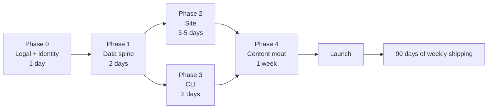

# Open-Sourcing All-AI — Strategy & Execution Plan

> Status: draft v1 · Owner: Akshat · Generated from an audit of the repo on 2026-10-28

---

## 1. Verdict

**You have the raw material for something people actually want, but the current repo is not it yet.**

What you have:

| Asset | Reality |
|---|---|
| 284 `SKILL.md` files | Real, but 100% copied from 6 upstream repos. Zero original IP. |
| 416+ prompts | One 5.6 MB scraped blob + 256 MIT-licensed Fabric patterns. |
| Agents / memory / templates | Thin, mostly placeholders (7 stack READMEs, 2 real agents). |
| Import machinery (PIN gate) | Solves a private-repo problem. Irrelevant — actively confusing — in public. |
| `scripts/scan-repos.js` | Genuinely useful. This is the seed of the real product. |
| Docs | Half-finished; `README` already links to a `skills/README.md` that doesn't exist. |

**The blunt truth:** a public dump of other people's skills gets ~40 stars, one "thanks for compiling", zero traction, and a license headache. Repos that win in this space are **products with a data spine**: searchable, installable, verified, attributable.

Your unfair advantage is not the 284 files. It is that **you already built the pipeline that finds, imports, and organizes them** — and nobody has built a *verified, machine-readable registry* with one-command cross-agent install.

**Recommendation (accepted):** don't publish this repo as it stands. Publish a **successor identity**: a registry + CLI + static site, named **Aidentity**, with `anthropics/skills` content removed, built on the data you already have. Rewrite the git history to a single clean initial commit before the repo becomes public, so no scraped blob or PIN hash ships in the log.

---

## 2. Hard blockers before you flip the switch

### 2.1 Licensing — this is a real problem, not a formality

| Source | Upstream license | Can you redistribute? | Action |
|---|---|---|---|
| `mattpocock/skills` | MIT | ✅ Yes, with notice | Vendor + keep `LICENSE` |
| `obra/superpowers` | MIT | ✅ Yes, with notice | Vendor + keep `LICENSE` |
| `addyosmani/agent-skills` | MIT | ✅ Yes, with notice | Vendor + keep `LICENSE` |
| `google/skills` (127) | Apache-2.0 | ✅ Yes, with `NOTICE` | Vendor + keep `LICENSE`/`NOTICE` |
| `microsoft/skills` (61) | MIT | ✅ Yes, with notice | Vendor + keep `LICENSE` |
| **`anthropics/skills` (19)** | **No license — all rights reserved** | **❌ No** | **Delete content. Keep pointer entries in the registry only.** |
| `danielmiessler/fabric` (256 prompts) | MIT | ✅ Yes | Keep, attribute |
| `f/prompts.chat` (5.6 MB dump) | `NOASSERTION` | ⚠️ Unclear | Verify `LICENSE` upstream or link out; do not vendor |

Anthropic's per-skill `LICENSE.txt` is explicit:

> "users may not: Extract these materials from the Services or retain copies of these materials outside the Services … Reproduce or copy these materials … Create derivative works"

Publishing those 19 skills would be a straightforward violation and the fastest way to get a DMCA takedown on launch day. The repo currently contains 19 of them. **This is blocker #1.**

**Do this instead:** index them. A registry entry with the skill's name, a description *in your own words*, the upstream URL, its license status and an install pointer is nominative fair use — the same thing every package index and search engine does. You keep the coverage, you drop the liability.

### 2.2 Other pre-flight items

- **Root `LICENSE` is missing.** Everything defaults to all-rights-reserved, which contradicts "open source".
- **`README` says "Private repository — for internal use only."** Must be rewritten from scratch.
- **PIN gate + obscure alias** in `README`/`AGENTS.md`/`opencode/` — delete. In public it reads as sketchy and breaks the one-phrase import story.
- **5.6 MB `chatgpt-prompts.md`** — removed. CC0, so it was legal, but it dominated clone size and duplicates an actively maintained dataset.
- **Git LFS filters in `.gitattributes`** for `*.png`/`*.svg` with no LFS objects — will break contributors who clone without LFS.
- **Broken link:** `README` → `skills/README.md` (doesn't exist).
- **`.env` / secrets:** none found. Good.

---

## 3. Positioning

### What to be

> **The verified, machine-readable index of agent skills — one ID, one command, works in every coding agent.**

Three claims nobody else currently makes together:

1. **Verified** — CI re-checks every upstream URL weekly and stamps `verified_at`. Dead entries are auto-flagged. "This list doesn't rot."
2. **Portable** — one skill ID installs into Claude Code, OpenCode, Codex, Cursor, Copilot, Gemini CLI. The registry owns the mapping, not the user.
3. **Legible** — every entry states its license, author, and origin. The thing enterprises need before they'll touch it.

### What not to be

- ❌ Another `awesome-*` list. There are 7+ already, and your own `scan-repos.js` monitors them. You will lose.
- ❌ A vendored content dump. 37 MB of other people's work, no reason to star, no reason to return.
- ❌ A "marketplace" with accounts and reviews. Too heavy for v1.

### The one-liner

> "npm for agent skills — search, verify, install."

---

## 4. Naming

`all-ai` is un-Googleable, collides with a thousand repos, and says nothing. Rename **before** launch (GitHub redirects old URLs, and the repo is private, so renaming is free right now).

**Decided: `aidentity`.** Repo `aidentity`, site `aidentity.dev`, CLI `npx aidentity`. Everything in this plan and the generated registry uses that name.

---

## 5. Target architecture

```
aidentity/
├── README.md                  # the product page — screenshot, 30s demo, install
├── LICENSE                    # MIT — code + original skills
├── LICENSE-DATA               # CC0 — registry/*.json (max reuse)
├── THIRD_PARTY_NOTICES.md     # generated; one block per upstream
├── registry/
│   ├── skills.json            # ✅ generated: 284 entries, provenance, license, install
│   ├── tools.json             # AI tools index (the "library" half of the pitch)
│   ├── bundles.json           # curated stacks
│   └── schema.json            # ✅ JSON Schema, versioned
├── skills/                    # only redistributable sources (265 entries)
│   ├── mattpocock/            # + LICENSE per source
│   ├── google-cloud/          # + LICENSE + NOTICE
│   └── ...
├── bundles/                   # "ship-a-saas", "security-audit", "rag-builder"
├── site/                      # Astro + Pagefind → GitHub Pages
│   ├── src/pages/skills/[id].astro
│   ├── src/pages/browse.astro
│   └── public/llms.txt        # agents can read the registry directly
├── cli/                       # npx aidentity add|search|list|bundle
├── scripts/
│   ├── build-registry.js      # ✅ done
│   ├── verify-sources.js      # weekly: HEAD each source URL, stamp verified_at
│   └── check-licenses.js      # fails CI if a non-distributable source is vendored
└── .github/
    ├── workflows/{deploy,verify,pr-checks}.yml
    └── ISSUE_TEMPLATE/{submit-skill.yml,broken-entry.yml}
```

**Why registry-first:** the JSON is the product. The site renders it, the CLI reads it, agents consume it, contributors only ever edit one record. One data change propagates everywhere — that's what makes maintenance survivable and contribution frictionless.

---

## 6. Phases



Phase 0 is a hard gate. Nothing ships publicly before it passes.

### Phase 0 — Legal & identity (1 day) 🔴 blocking
- [ ] Delete `skills/anthropic-official/**` content; keep pointer entries in the registry (`distributable: false`)
- [ ] Resolve `f/prompts.chat` license or remove the 5.6 MB dump
- [ ] Add `LICENSE` (MIT), `LICENSE-DATA` (CC0), generate `THIRD_PARTY_NOTICES.md`
- [ ] Add upstream `LICENSE`/`NOTICE` into each `skills/<source>/`
- [ ] Rename repo + reserve domain/handle
- [ ] Delete PIN gate, obscure alias, "private/internal" language everywhere

**Exit:** `scripts/check-licenses.js` passes; no content from a non-permissive upstream remains.

### Phase 1 — Data spine (2 days)
- [x] `registry/skills.json` + `schema.json` + builder
- [ ] `verify-sources.js` + weekly Action that stamps `verified_at` and opens an issue on dead links
- [ ] `check-licenses.js` in CI
- [ ] `registry/tools.json` seeded (20–30 real entries: editors, CLIs, MCP servers, eval tools)

**Exit:** CI green; registry reproducible via `node scripts/build-registry.js --check`.

### Phase 2 — The site (3–5 days) ← this is what people share
- [ ] Astro + Pagefind, fully static, no server
- [ ] `/browse` — search + facet by category / agent / license
- [ ] `/skills/<id>` — one page per skill: what it does, install snippet per agent, source, license, "verified on" date
- [ ] `/bundles/<slug>` — curated stacks
- [ ] `/tools` — the tools library
- [ ] `llms.txt`, `sitemap.xml`, `schema.org` `ItemList`
- [ ] OG images auto-generated per skill (the shareable unit)

**Exit:** Lighthouse ≥ 95; 265 static skill pages indexed; search works offline.

### Phase 3 — CLI (2 days) ← this is what makes it a habit
```bash
npx aidentity search code review
npx aidentity add mattpocock/engineering/code-review   # auto-detects Claude Code / OpenCode / Cursor / Codex
npx aidentity bundle add ship-a-saas
npx aidentity verify
```
- [ ] Resolve target agent from cwd (`.claude/`, `.opencode/`, `.codex/`, `.cursor/`, `.github/`)
- [ ] `--dry-run`, `--json` for agents
- [ ] Publish to npm as `aidentity`

**Exit:** `npm i -g aidentity && aidentity add X` works from a clean machine.

### Phase 4 — Content moat (1 week, ongoing)
- [ ] **The link-rot report** — run the verifier across the 7 awesome-lists already listed in `scripts/scan-repos.js`, publish the dead-link rate. Something like *"I checked 1,200 links across 7 agent-skill lists. A third were dead."* This is the one asset that gets shared on HN and cited by other posts, because it proves the thesis with data instead of asserting it.
- [ ] 6–8 bundle pages (these are the viral artifacts — people share *playbooks*, not file lists)
  - `ship-a-saas`, `security-audit`, `rag-builder`, `frontend-polish`, `cloud-cost-cut`, `code-review-stack`
- [ ] "How agent skills actually work" — the canonical explainer (linkable, evergreen)
- [ ] "The 20 skills worth installing first" — opinionated ranking with criteria
- [ ] Comparison pages: `aidentity vs awesome-lists`, `Claude Code vs OpenCode skills`
- [ ] Weekly auto-post: "New & verified this week"

**Exit:** 10+ pages that are worth linking to on their own merits.

---

## 7. Launch playbook

### T-14 → T-1 (seed)
1. **Open 30–50 "good first issue: add a skill"** tasks. Merge every one within 24h. Contributors who get merged become sharers.
2. **Ask the 6 upstream maintainers for a link.** You are indexing their work with attribution and sending them traffic. Matt Pocock, Jesse Vincent, Addy Osmani, Google, Microsoft — a short, specific DM/issue. This is the single highest-leverage distribution move available to you: their combined audience is enormous, and "we're featured in the index" is an easy yes.
3. **Seed 5 design partners**: people who will install and post a screenshot on launch day.
4. **Record a 30-second demo** — terminal, `npx aidentity add`, skill appears, agent uses it. No slides.

### T-0 (launch day — Tuesday/Wednesday/Thursday, 7–9am PT)
Pick **one** primary and cross-post:

| Channel | Post |
|---|---|
| Hacker News | `Show HN: A verified registry of 284 agent skills, installable in one command` — factual, no adjectives, first comment = the license story |
| Product Hunt | "Aidentity — npm for agent skills" |
| r/ClaudeAI, r/LocalLLaMA, r/ChatGPTCoding | demo GIF + the "verified, not another list" angle |
| X / LinkedIn | thread: the rot problem → the index → the CLI → the license table |
| dev.to / Hashnode | "I indexed 284 agent skills and found out most lists are dead links" |

**Do not** ask for upvotes, do not use hype words in the HN title, do not launch on a Friday.

### T+1 → T+30 (the part that actually matters)
- Reply to every comment within 2h on launch day.
- Ship a visible change every week: new bundle, 20 new entries, CLI flag, "verified" badge.
- Weekly "New & verified" post + RSS. Consistency beats one big spike.
- Open a **"request a skill"** issue template; publish the top requests.
- Add a **README badge** others can embed:
  `` — every embed is a backlink and a brand impression.

### Reality check
One launch will not make this famous. In this niche, traction comes from: being the *first verified* index + a genuinely great demo + upstream maintainers amplifying + showing up weekly for 8–12 weeks. Plan for the 90 days, not the day.

---

## 8. Growth loops (ranked by leverage)

1. **Upstream maintainer loop** — they get traffic and a "verified" badge; you get their audience. Highest leverage, do it first.
2. **Contributor loop** — editing one JSON record is a 30-second PR. Fast merges → contributors tweet their entry.
3. **Agent loop** — publish `registry/skills.json` + `llms.txt`. When someone asks ChatGPT/Claude/Perplexity "what skills should I install", you want to be the cited source. This is the 2026 distribution channel and almost nobody in this space is doing it deliberately.
4. **SEO loop** — 265 long-tail pages (`/skills/<id>`) + 10 category pages + comparison pages + `schema.org`. Slow, compounding, durable.
5. **Badge loop** — maintainers embed the badge; backlinks compound.
6. **Newsletter/RSS** — own the audience instead of renting it from X.

---

## 9. Metrics that matter

| Metric | Why | Target (90 days) |
|---|---|---|
| Weekly npm installs | Actual usage, not applause | 1,000/wk |
| Unique visitors | Reach | 15k/mo |
| Registry PRs merged | Community health | 40/mo |
| Dead-link rate | The moat, quantified | < 2% |
| Backlinks / referring domains | SEO compounding | 50 |
| GitHub stars | Vanity, but social proof | 2k |

Stars are a lagging indicator. Installs and merged PRs are the leading ones.

---

## 10. Risk register

| Risk | Likelihood | Mitigation |
|---|---|---|
| DMCA / license complaint | **High if shipped as-is** | Phase 0. Pointer-only for Anthropic. Generated notices. CI license check. |
| "Just another awesome list" dismissal | High | Lead with verified + CLI + license data, never with "curated collection". |
| Registry rot | Certain without automation | Weekly `verify-sources` Action; auto-issue on 404; visible `verified_at`. |
| Maintainer burnout | High | Automate ingestion; accept only data PRs; bundles are the only editorial work. |
| Name collision / squatting | Medium | Rename + reserve handle/domain before launch. |
| 5.6 MB blob + LFS breaking clones | Certain | Remove both. Keep the repo under 5 MB. |
| Low-quality submissions | Medium | Schema validation in CI + `status` field + editorial bundles only. |

---

## 11. What has been built

**Data spine**
- ✅ `registry/sources.json` — single source of provenance truth (license, author, publishable)
- ✅ `scripts/build-registry.js` → `registry/skills.json` — 284 entries, 265 distributable, id / category / tags / status / path / source / license / install
- ✅ `registry/schema.json` — versioned JSON Schema, validated in CI
- ✅ `registry/pointers/anthropic-official.json` — 19 metadata-only entries for non-redistributable skills
- ✅ `scripts/verify-sources.js` → `registry/verified.json` — weekly reachability; 6/6 upstreams alive

**Legal**
- ✅ `scripts/check-licenses.js` — the gate. Now passes; Anthropic content removed
- ✅ `scripts/generate-notices.js` → `THIRD_PARTY_NOTICES.md`
- ✅ Upstream `LICENSE` files vendored for all five redistributable sources
- ✅ `LICENSE` (MIT) + `LICENSE-DATA` (CC0)

**Product**
- ✅ `site/build.js` — zero-dependency generator: home, browse with faceted search, 284 skill pages with rendered SKILL.md content, sources, about, 404, `llms.txt`, `sitemap.xml`, `robots.txt`
- ✅ `site/assets/style.css` — editorial design, light + dark, responsive, no framework
- ✅ `cli/index.js` — `search`, `info`, `add`, `list`, `agents`; auto-detects six agents
- ✅ `package.json` — publishable as `aidentity` (2.1 MB tarball)
- ✅ `README.md`, `CONTRIBUTING.md`, `skills/README.md`, issue forms

**CI**
- ✅ `.github/workflows/registry.yml` — reproducible registry, license gate, notices freshness, weekly verify + auto-issue on dead sources
- ✅ `.github/workflows/deploy-pages.yml` — builds the registry and site, deploys `site/dist`

### Verification

```
$ node scripts/check-licenses.js
License check passed (1 warning).

$ node scripts/verify-sources.js
6/6 sources reachable → registry/verified.json

$ node site/build.js
Built 289 pages → site/dist

$ node cli/index.js add mattpocock/engineering/code-review
installed code-review → .claude/skills/code-review
```

The license gate surfaced the Anthropic problem before a lawyer did. That is the point of building it first.


## 12. Decisions (resolved 2026-10-28)

| Decision | Choice |
|---|---|
| Name | **aidentity** — repo `aidentity`, site `aidentity.dev`, CLI `npx aidentity` |
| Anthropic skills | Content deleted; 19 pointer entries in `registry/pointers/anthropic-official.json` |
| Repository | Rewrite in place, then collapse history to one clean commit before publishing |
| First build | The site (done) |

### Remaining before public

1. ✅ **History squashed.** Single commit `aidentity v1.0.0`, 1,548 files, no `chatgpt-prompts.md`, no `.pin.hash`, no Anthropic content in the tree. Local backup branch `backup/pre-squash` holds the old history and is **not** pushed.
2. ✅ **5.6 MB prompt dump removed.** `prompts/` is now 2.1 MB; sources are linked instead.
3. ✅ **Repo renamed** to `aidentity` (GitHub already redirects `all-ai`).
4. ⏳ **Force-push blocked:** the active `gh` token lacks the `workflow` scope, so GitHub rejects any push that creates `.github/workflows/*`. Run `gh auth refresh -h github.com -s workflow`, then `git push --force origin main`.
5. ⏳ **Publish the CLI** (`npm publish`) so `npx aidentity` resolves.
6. ⏳ **Decide on `prompts/`, `agents/`, `memory/`, `templates/`.** They are real content but outside the registry's maintained surface. If they stay, the README must say so plainly.
7. ⏳ **Enable Pages → GitHub Actions.** The workflow reads `steps.pages.outputs.base_url` automatically.


